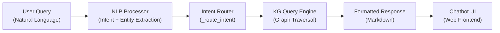
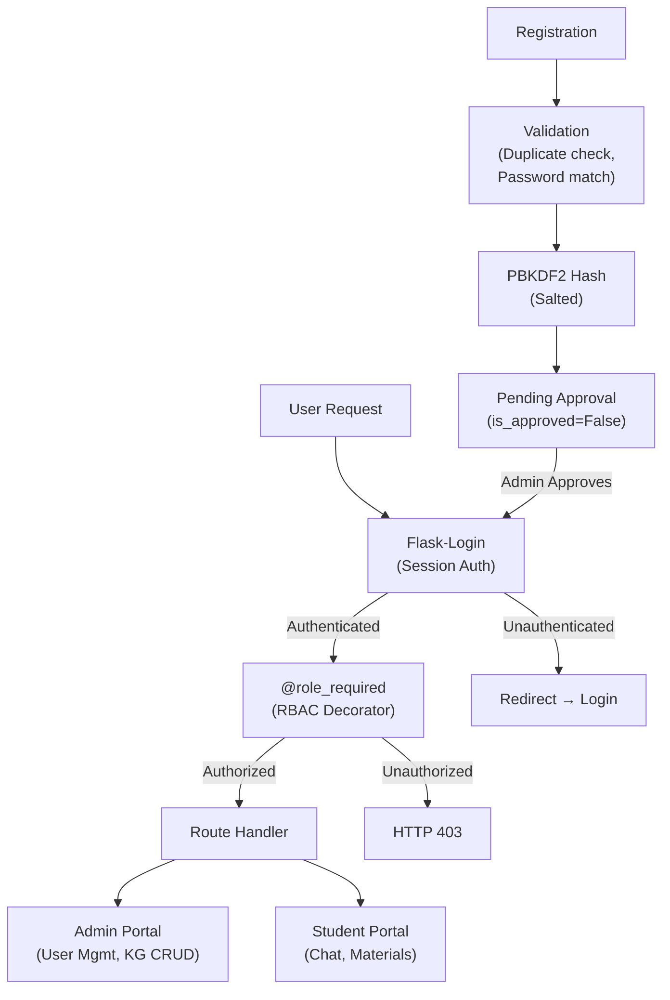
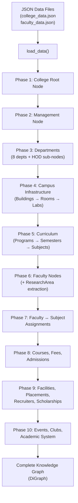

# 📋 Project Overview — KG-RAG Campus Assistant

## 🏷️ Project Title (IEEE Format)
**KG-RAG: An Ontology-Driven Knowledge Graph Framework for Intelligent Campus Information Retrieval and Natural Language Question Answering in Higher Education Institutions**

---

## 🌐 Domain
**Artificial Intelligence / Natural Language Processing / Knowledge Representation & Reasoning**

Specifically: **Intelligent Question Answering Systems for Educational Institutions using Knowledge Graphs**

Sub-domains touched:
- Knowledge Graph Construction & Querying
- NLP-based Intent Classification & Entity Extraction
- Conversational AI (Chatbot)
- Ontology-driven Information Retrieval
- Multi-role Web-based Information Management Systems

---

## 📊 Dataset

### Type: **Custom / Self-Curated Domain-Specific Dataset**

The project does **NOT** use a standard benchmark dataset (e.g., from Kaggle or UCI). Instead, it uses **two hand-crafted JSON datasets** specific to **Sphoorthy Engineering College**:

| File | Description | Key Entities Covered |
|---|---|---|
| [`college_data.json`](file:///c:/Users/lucky/JC-Rella%20Su-6372/major%20project/data/college_data.json) | Primary campus knowledge base (475 lines) | College metadata, 8 departments, courses, fees, admissions, placements, facilities, scholarships, events, clubs, campus infrastructure (buildings, rooms, labs), curriculum (programs → semesters → subjects), faculty assignments |
| [`faculty_data.json`](file:///c:/Users/lucky/JC-Rella%20Su-6372/major%20project/data/faculty_data.json) | Faculty profiles per department | Faculty name, designation, qualification, experience, research areas, department mapping |

### Dataset Statistics (Approximate)
- **8 Departments**: CSE, CSE (AI&ML), CSE (DS), CSE (CS), ECE, Civil, Mechanical, MBA
- **24+ Entity Types**: College, Department, Faculty, Subject, Lab, Course, Building, Room, Semester, Program, etc.
- **30+ Relationship Types**: `has_department`, `has_faculty`, `teaches`, `offers_subject`, `housed_in`, `has_room`, etc.
- **KG Nodes**: Hundreds (departments + faculty + subjects + buildings + rooms + labs + events + clubs + recruiters + ...)
- **KG Edges**: Hundreds of typed relationships linking all entities

### Data Source
Real-world institutional data from **Sphoorthy Engineering College** — manually collected and structured into JSON format.

---

## ⚙️ Methodology

The system follows a **multi-stage NLP → Knowledge Graph → Response Generation pipeline**:

### Stage 1 — Knowledge Graph Construction ([`kg_builder.py`](file:///c:/Users/lucky/JC-Rella%20Su-6372/major%20project/knowledge_graph/kg_builder.py))
- Load structured JSON data
- Validate entities against a formal **Ontology Schema** ([`ontology.py`](file:///c:/Users/lucky/JC-Rella%20Su-6372/major%20project/knowledge_graph/ontology.py))
- Build a **NetworkX Directed Graph (DiGraph)** with typed nodes and typed edges
- Establish hierarchical relationships: College → Departments → Faculty → Subjects, Buildings → Rooms → Labs, Programs → Semesters → Subjects

### Stage 2 — NLP Processing ([`nlp_processor.py`](file:///c:/Users/lucky/JC-Rella%20Su-6372/major%20project/knowledge_graph/nlp_processor.py))
- **Intent Classification**: Keyword-based priority rules + TF-IDF cosine similarity fallback
- **Entity Extraction**: Regex-based pattern matching for departments, courses, faculty names, buildings, semesters
- **Multi-turn Context Management**: Carries forward department/course context from previous turns (dialogue state tracking)

### Stage 3 — Knowledge Graph Querying ([`kg_query.py`](file:///c:/Users/lucky/JC-Rella%20Su-6372/major%20project/knowledge_graph/kg_query.py))
- Graph traversal over NetworkX DiGraph (successor/predecessor walks)
- Type-filtered node search (`_get_nodes_by_type`)
- String-matched entity lookup (fuzzy department/faculty matching)
- Structured response formatting in Markdown

### Stage 4 — Web Application ([`app.py`](file:///c:/Users/lucky/JC-Rella%20Su-6372/major%20project/app.py))
- Flask web server with Blueprints (auth, admin portal)
- REST API: `/api/chat`, `/api/notices`, `/api/materials`, `/api/feedback`
- Multi-role auth: Admin (CRUD on KG, notices, materials), Student (chatbot, study hub)
- Chat logging to SQLite DB with response time tracking

---

## 🧮 Algorithms & Techniques Used

| # | Algorithm / Technique | Where Used | Purpose |
|---|---|---|---|
| 1 | **TF-IDF Vectorization** | [`nlp_processor.py`](file:///c:/Users/lucky/JC-Rella%20Su-6372/major%20project/knowledge_graph/nlp_processor.py) | Convert user queries and training sentences into numerical vectors using Term Frequency–Inverse Document Frequency with bigrams `(1,2)` |
| 2 | **Cosine Similarity** | [`nlp_processor.py`](file:///c:/Users/lucky/JC-Rella%20Su-6372/major%20project/knowledge_graph/nlp_processor.py) | Measure similarity between user query vector and training intent vectors for intent classification (threshold > 0.25) |
| 3 | **Keyword-Priority Rule Matching** | [`nlp_processor.py`](file:///c:/Users/lucky/JC-Rella%20Su-6372/major%20project/knowledge_graph/nlp_processor.py) | Ordered longest-match-first keyword rules for fast, deterministic intent detection before TF-IDF fallback |
| 4 | **Regex-Based Entity Extraction** | [`nlp_processor.py`](file:///c:/Users/lucky/JC-Rella%20Su-6372/major%20project/knowledge_graph/nlp_processor.py) | Extract departments, course names, faculty names, semester numbers, building names using regex patterns |
| 5 | **Fuzzy String Matching** | [`nlp_processor.py`](file:///c:/Users/lucky/JC-Rella%20Su-6372/major%20project/knowledge_graph/nlp_processor.py) | `difflib.get_close_matches()` with 0.8 cutoff for misspelled department names |
| 6 | **Knowledge Graph Construction** | [`kg_builder.py`](file:///c:/Users/lucky/JC-Rella%20Su-6372/major%20project/knowledge_graph/kg_builder.py) | Build a typed directed graph (NetworkX DiGraph) from structured JSON with ontology validation |
| 7 | **Graph Traversal (BFS/DFS over DiGraph)** | [`kg_query.py`](file:///c:/Users/lucky/JC-Rella%20Su-6372/major%20project/knowledge_graph/kg_query.py) | Navigate successor/predecessor relationships to answer multi-hop queries (e.g., Faculty → Department → Building) |
| 8 | **Ontology Schema Validation** | [`ontology.py`](file:///c:/Users/lucky/JC-Rella%20Su-6372/major%20project/knowledge_graph/ontology.py) + [`er_schema.py`](file:///c:/Users/lucky/JC-Rella%20Su-6372/major%20project/knowledge_graph/er_schema.py) | Formal entity-relationship schema with required/optional field constraints and edge-type validation |
| 9 | **Dialogue State Tracking (Context Carry-Forward)** | [`nlp_processor.py`](file:///c:/Users/lucky/JC-Rella%20Su-6372/major%20project/knowledge_graph/nlp_processor.py) + [`app.py`](file:///c:/Users/lucky/JC-Rella%20Su-6372/major%20project/app.py) | Multi-turn conversation management — inherits department/course context from previous turn |
| 10 | **Intent Routing Pipeline** | [`app.py`](file:///c:/Users/lucky/JC-Rella%20Su-6372/major%20project/app.py) `_route_intent()` | Maps classified intents (17+ types) to specific KG query functions |

---

## 🔒 Security Mechanisms

Your project implements a **multi-layered security architecture**:

### 1. Password Security — Werkzeug PBKDF2 Hashing
[`user.py`](file:///c:/Users/lucky/JC-Rella%20Su-6372/major%20project/models/user.py) uses `werkzeug.security.generate_password_hash()` and `check_password_hash()`.

- **Algorithm**: PBKDF2-SHA256 (Password-Based Key Derivation Function 2)
- Passwords are **never stored in plain text** — only salted hashes
- Each hash includes a unique random **salt** to prevent rainbow table attacks
- Verification uses constant-time comparison to prevent timing attacks

### 2. Role-Based Access Control (RBAC)
[`decorators.py`](file:///c:/Users/lucky/JC-Rella%20Su-6372/major%20project/auth/decorators.py) implements a `@role_required()` decorator.

| Role | Access Level |
|---|---|
| `admin` | Full access — KG management, user approval, analytics, notices, materials CRUD |
| `faculty` | Faculty portal (future phase) |
| `hod` | Department-level management (future phase) |
| `placement_officer` | Placement data management (future phase) |
| `student` | Chatbot, student hub, study materials, view notices |

- Unauthorized access returns **HTTP 403 Forbidden**
- Admin routes are protected with `@login_required` + `@role_required('admin')` double-guard

### 3. Admin Approval Gating
[`routes.py`](file:///c:/Users/lucky/JC-Rella%20Su-6372/major%20project/auth/routes.py) — new registrations are **NOT auto-activated**.

- `is_approved = False` by default on registration
- Only `admin` can approve/reject/deactivate users from the admin portal
- Unapproved users see: *"Your account is pending admin approval"*
- Prevents unauthorized self-registration attacks

### 4. Session Management — Flask-Login
- Server-side session tracking via `Flask-Login`
- `@login_required` protects all authenticated routes
- Automatic redirect to login page for unauthenticated access
- Safe `next` page redirect after login (prevents open redirect partially)

### 5. Input Handling & Data Integrity
- **Duplicate user prevention**: Registration checks both username AND email uniqueness
- **Password confirmation**: `password != confirm_password` validation
- **File upload safety**: `werkzeug.utils.secure_filename()` sanitizes uploaded filenames + UUID prefix prevents overwrites
- **Ontology validation**: Every KG node and edge is validated against the schema before insertion (`validate_node`, `validate_edge`)

### 6. Environment Variable Protection
[`config.py`](file:///c:/Users/lucky/JC-Rella%20Su-6372/major%20project/config.py) loads secrets via `.env` file:
- `SECRET_KEY` — Flask session signing (protects against session tampering)
- `DATABASE_URL` — DB credentials kept out of source code
- `GEMINI_API_KEY` — API key isolation
- `.gitignore` excludes `.env` from version control

### Security Architecture Summary

---

## 🏗️ Knowledge Graph Construction (Detailed)

The graph is built in [`kg_builder.py`](file:///c:/Users/lucky/JC-Rella%20Su-6372/major%20project/knowledge_graph/kg_builder.py) using a **10-phase orchestrated pipeline**:

### Graph Type
**NetworkX Directed Graph (`nx.DiGraph`)** — each node has a `node_type` and `data` dict, each edge has a `relationship` label.

### Construction Pipeline

### Phase Details

| Phase | Method | Nodes Created | Relationships Created |
|---|---|---|---|
| 1 | `_build_college()` | `College` (root) | — |
| 2 | `_build_management()` | `Management` | College → Management |
| 3 | `_build_departments()` | `Department` × 8, `HOD` × 8 | College → Department, Department → HOD |
| 4 | `_build_campus_infrastructure()` | `Building`, `Room`, `Lab` | College → Building, Building → Room, Department → Building (`housed_in`), Lab → Room (`lab_in`) |
| 5 | `_build_curriculum()` | `Program`, `Semester`, `Subject` | Department → Program → Semester → Subject, Subject → Semester (`offered_in`), Subject → Lab (`uses_lab`) |
| 6 | `_build_faculty()` | `Faculty`, `ResearchArea` | Faculty → Department (`belongs_to`), Department → Faculty (`has_faculty`), Faculty → ResearchArea (`researches`) |
| 7 | `_build_faculty_assignments()` | — | Faculty → Subject (`teaches`) |
| 8 | `_build_courses/fees/admissions()` | `Course`, `Fee`, `Admission` | College → Course/Fee/Admission |
| 9 | `_build_facilities/placements/scholarships()` | `Facility`, `Placement`, `Recruiter`, `Scholarship` | College → each, Placement → Recruiter |
| 10 | `_build_events/clubs/academic_system()` | `Event`, `Club`, `AcademicSystem` | College → each |

### Ontology Validation Layer
Every node and edge passes through [`ontology.py`](file:///c:/Users/lucky/JC-Rella%20Su-6372/major%20project/knowledge_graph/ontology.py) validators:

- **`validate_node(node_type, data)`** — checks that all required fields exist for the entity type
- **`validate_edge(rel_type, source_type, target_type)`** — checks that the relationship is valid between the given source/target types
- **24 Entity Types** defined with required/optional field schemas
- **30 Relationship Types** defined with strict source → target type constraints

### Intelligent Features in Construction
- **Research Area auto-extraction**: Parses `Ph.D.(Topic)` from faculty qualification strings using regex, auto-creates `ResearchArea` nodes
- **Lab-Subject auto-linking**: Lab-type subjects are fuzzy-matched to Lab room nodes via name similarity
- **Deduplication**: Subject nodes with identical codes across departments are not duplicated
- **Bidirectional edges**: Faculty ↔ Department uses both `belongs_to` and `has_faculty` for bi-directional traversal

### Dynamic Synchronization (Admin Hot-Reload)
From [`admin/routes.py`](file:///c:/Users/lucky/JC-Rella%20Su-6372/major%20project/portals/admin/routes.py):
- Admin can trigger **live KG rebuild** without server restart
- Reconstructs the entire graph from updated JSON in-memory
- Benchmarked rebuild latency tracked in [`benchmark_system.py`](file:///c:/Users/lucky/JC-Rella%20Su-6372/major%20project/benchmark_system.py)

### DB-Backed Entity/Relationship Persistence
[`entity.py`](file:///c:/Users/lucky/JC-Rella%20Su-6372/major%20project/models/entity.py) provides SQLAlchemy models for persistent storage:
- `KGEntity` — stores entity type, name, JSON data, created_by (audit trail)
- `KGRelationship` — stores source/target entity IDs, relationship type, weight, metadata

---

## 🛠️ Technology Stack

| Layer | Technology |
|---|---|
| **Backend** | Python, Flask 3.1 |
| **Knowledge Graph** | NetworkX (Directed Graph) |
| **NLP / ML** | scikit-learn (TF-IDF, Cosine Similarity) |
| **Database** | SQLite (via Flask-SQLAlchemy) / PostgreSQL-ready |
| **Authentication** | Flask-Login (multi-role: admin, student, faculty) |
| **Frontend** | HTML/CSS/JS, Jinja2 templates, chatbot widget |
| **Visualization** | D3.js (KG visualization), Mermaid (ER diagrams) |
| **Deployment** | Gunicorn, Render (render.yaml) |

---

## 📝 Summary (for report/abstract)

> This project presents **KG-RAG**, an intelligent campus knowledge management system that constructs an **ontology-driven Knowledge Graph** from institutional data and enables **natural language question answering** via a conversational chatbot. The system employs a **TF-IDF + Cosine Similarity** pipeline for intent classification, **regex-based entity extraction** with fuzzy matching, and **graph traversal** over a NetworkX DiGraph for structured information retrieval. A **multi-role Flask web application** provides students, faculty, and administrators with role-specific portals for accessing campus information, study materials, and official notices — all powered by the underlying Knowledge Graph.
